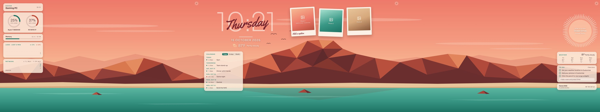
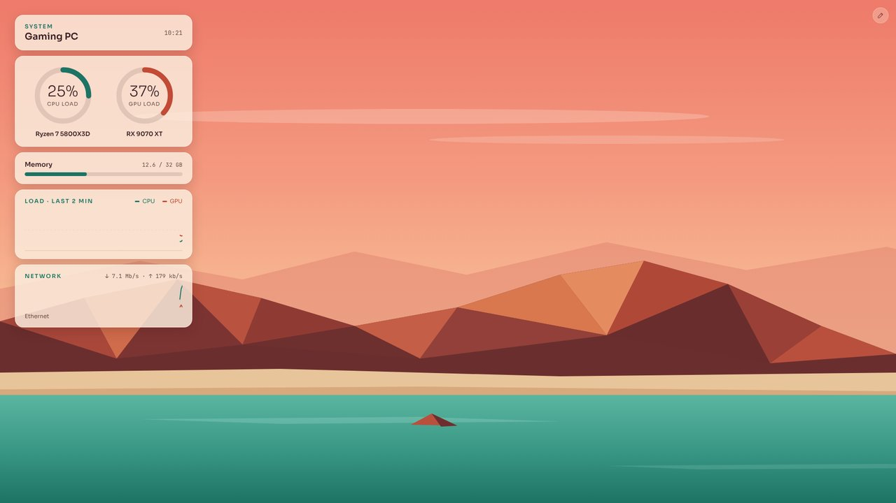
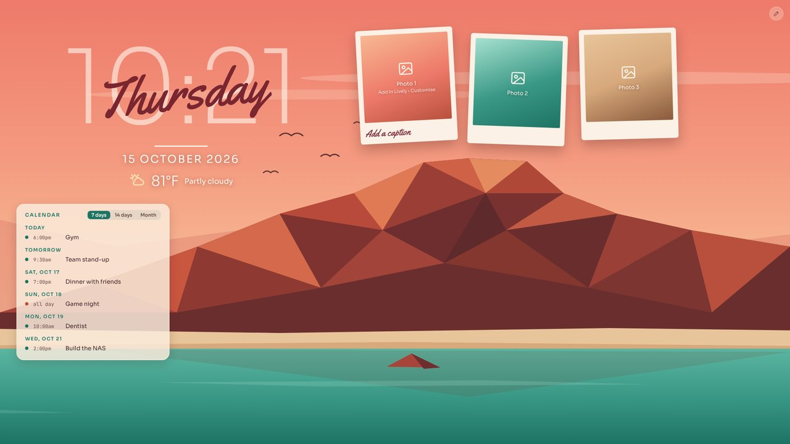
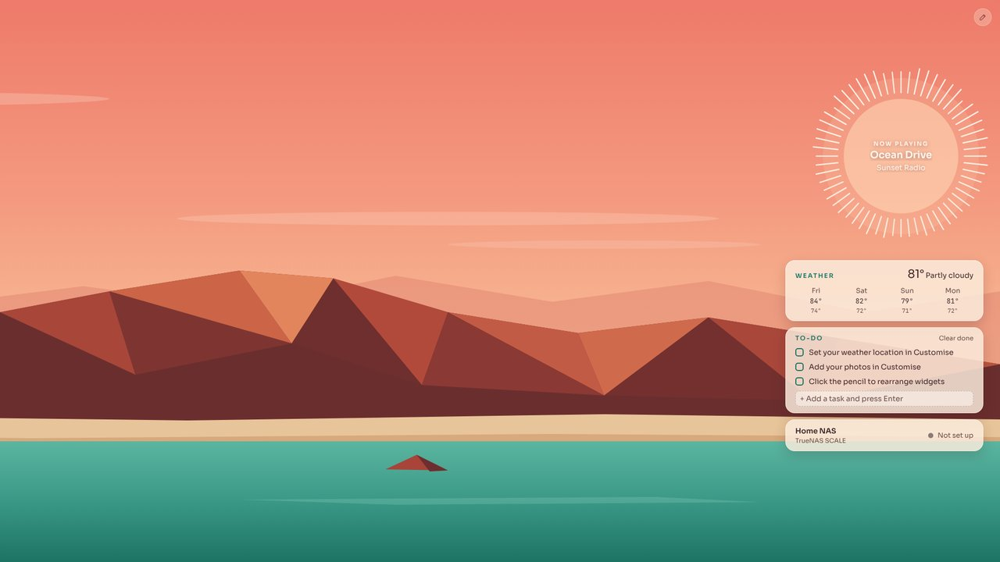
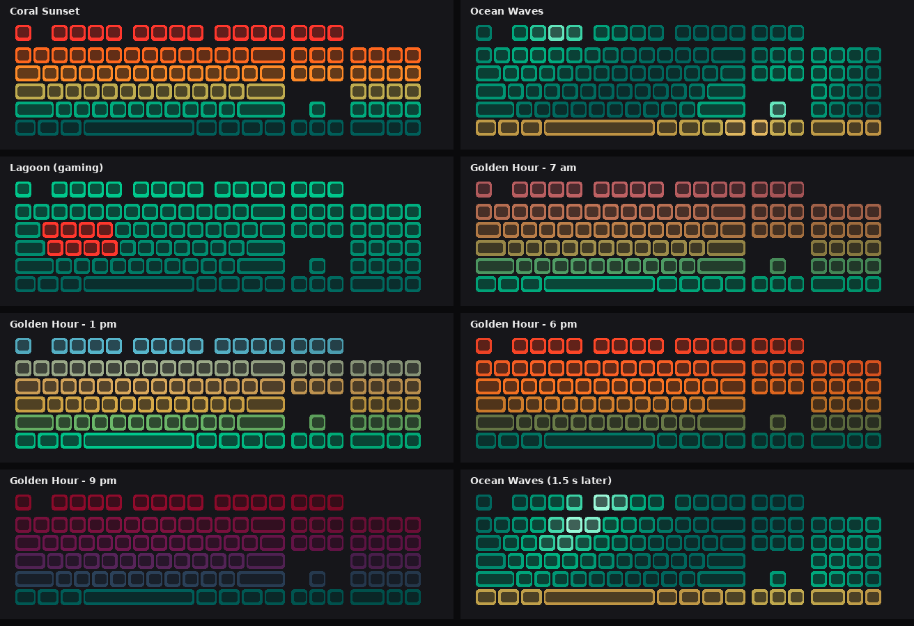

# Coral Coast Desktop

A triple-monitor desktop setup for Windows in teal, coral and sandstone. It has two parts that work together:

- **Coral Coast wallpaper**: a [Lively Wallpaper](https://www.rocksdanister.com/lively/) web wallpaper that spans three 1080p screens. It shows live system stats, a clock, photo frames, a Google Calendar, now-playing music, weather, a to-do list and NAS status. You can move every widget with the mouse.
- **Coral Launcher**: an app launcher that sits on the desktop just above the taskbar. It has category pop-ups, a Drives view, pinned favourites and instant search through [Everything](https://www.voidtools.com/). It's written in PowerShell + WPF, so there's nothing to install.



| Left: system | Center: clock, photos, calendar | Right: music and life |
|---|---|---|
|  |  |  |

## Features

**Wallpaper**

- **System (left):** CPU and GPU load rings, memory, a 2-minute load graph and network speed. The live numbers come from Lively.
- **Clock (center):** the time, the day in script lettering, the date and the current weather.
- **Photo frames:** three tilted photo frames with captions. You choose the pictures in Lively's Customise panel.
- **Calendar:** shows any number of Google or other iCal calendars, each with its own colour. There are **7 days**, **14 days** and **Month** views, and in Month view you can click a day to see its events.
- **Now playing (right):** the song playing in any Windows media app, inside a sun-ring audio visualizer.
- **Weather:** the current conditions and a 4-day forecast from [Open-Meteo](https://open-meteo.com/), which needs no API key. The place name is shown under the weather. Click it to type a city and pick the right match, or set coordinates in Customise.
- **To-do list:** tick items off and add new ones. Ticks stay ticked after a restart.
- **NAS card:** shows whether your NAS (e.g. TrueNAS) can be reached.
- **Widget boxes:** every widget sits in a standard box measured in grid cells (1 cell is 184×72 px, with 12 px gaps), so a 2×2 Network box and a 2×2 Temperatures box are exactly the same size.
- **Edit mode:** click the pencil in the top-right corner of any screen. Then:
  - drag a box to move it; it snaps to a half-cell grid and never overlaps another box;
  - drag the teal corner handle to resize it in whole cells; the content scales to fit;
  - use the ⋯ button to switch what a box shows, swap two widgets, reset the size, or remove it;
  - use **+ Add widget** to bring a removed one back.
- **Free widgets:** Now playing and the photo frames aren't tied to the grid. They move and resize freely, and Now playing's ⋯ menu has **Center on the sun**.
- **Photo collages:** in edit mode, drag a photo frame's round knob to rotate it (it snaps to straight when close). The frame you grab comes to the front. Each frame's ⋯ menu has **Choose picture…** (thumbnails from the launcher's `photoFolders`) and **Edit caption…**.
- **More of the same widget:** **+ Add widget → Add another** adds as many photo frames as you like, each with its own picture. It also adds live copies of display widgets (clock, weather, system, temperatures, calendar…). The to-do list and Now playing stay single.
- **Modules:** each widget is a module listed in `wallpaper/layout.js` (`MODULES`). A new widget is an HTML block plus one line there.

**Launcher**

- **Category tiles** (Games, Apps, Coding, Creative and so on) pop up a grid of the shortcuts in that folder.
- **Drives** shows every drive with a used-space bar.
- **Pinned favourites** launch with one click.
- **Search** covers your launcher folders, and with Everything running it also finds apps, files and folders anywhere on your PC.
- **Ctrl+Shift+Space** brings the launcher forward from anywhere.
- **A taskbar button**: the launcher adds a **Coral Launcher** entry to the Start menu. Right-click it and choose **More → Pin to taskbar**, and one click brings the launcher up with search ready (or starts it if it isn't running).
- **The bar lives on the desktop layer**, like a Rainmeter "on desktop" skin. Apps cover it and it sits in front of the wallpaper.
- **It runs a small local service for the wallpaper.** That's how the to-do list and layout are saved, calendars are fetched and new tasks are typed (see [How it works](docs/how-it-works.md)).

## Requirements

- **Windows 10 or 11.** PowerShell 5.1 is built in.
- **[Lively Wallpaper](https://www.rocksdanister.com/lively/)** from the Microsoft Store or GitHub.
- **Three 1920×1080 screens side by side.** The wallpaper is designed for a 5760×1080 span. Other setups work, but the layout is scaled to fit.
- **Optional:**
  - [Everything](https://www.voidtools.com/) for search across all your drives.
  - A Google Calendar.

## Install

1. Download this repository with **Code → Download ZIP** and unzip it somewhere permanent, for example `Documents\coral-coast-desktop`.

### The wallpaper

1. Make a Lively package. Right-click `tools\make-lively-zip.ps1` and choose **Run with PowerShell**. This creates `CoralCoast-Lively.zip` next to the repo folder.
   - To do it by hand instead, open the `wallpaper` folder, select everything inside it, then right-click → **Send to → Compressed (zipped) folder**.
2. In Lively, click **+ Add wallpaper** (or drag the zip onto the Lively window), pick the zip, and apply **Coral Coast**.
3. In Lively's settings, set the wallpaper arrangement to **Span** so one wallpaper covers all three screens.
4. Click the wallpaper's **⋯ → Customise** to set your weather location (latitude and longitude), photos and captions, starting to-dos and NAS address.

### The launcher

1. Double-click `launcher\CoralLauncher.vbs`. On the first run it:
   - creates `config.json` from `config.example.json`;
   - creates the folder `%USERPROFILE%\Coral Launcher` with one sub-folder per category;
   - adds itself to Windows startup (turn this off with `"startWithWindows": false`).
2. Drop shortcuts (`.lnk`, `.url` or `.exe`) into those category folders. A new sub-folder becomes a new tile, and folders whose names start with `_` are ignored.
3. Right-click the bar → **Refresh** to see your changes.

## Temperatures

Two widgets on the left screen show live temperatures:

- **Temperatures:** CPU and GPU gauges, plus RAM if your sticks have a sensor (otherwise the motherboard). Chips underneath show GPU hotspot, VRAM and the CPU's peak. Each gauge turns amber, then coral, as it gets hot.
- **Drive temps:** every NVMe and SATA drive at a glance.

Windows doesn't share temperature sensors with ordinary apps, so these come from [LibreHardwareMonitor](https://github.com/LibreHardwareMonitor/LibreHardwareMonitor), which is free and open source:

1. Download it, unzip it somewhere permanent, and run `LibreHardwareMonitor.exe`. It needs admin rights to read the sensors.
2. In its **Options** menu:
   - turn on **Remote Web Server → Run**;
   - tick **Run On Windows Startup**, **Start Minimized** and **Minimize To Tray**.
3. Optional: under **Remote Web Server → IP**, choose `127.0.0.1` so the sensor page is only reachable from this PC.

Coral Launcher reads LibreHardwareMonitor's sensor page on port 8085 (change it with `"sensorsPort"` in `config.json`) and passes the readings to the wallpaper. Customise has an option to show them in °F.

## Keyboard lighting (Corsair iCUE)

Coral Launcher can paint Corsair RGB keyboards (and mice, fans and strips) in Coral Coast colours through the iCUE SDK. Right-click the bar → **Keyboard lighting** to pick a theme:

| Theme | What it looks like |
|---|---|
| **Coral Sunset** | The wallpaper top to bottom: coral F-keys, amber and sand through the middle, teal down to the spacebar. |
| **Ocean Waves** | Slow teal waves with foam crests rolling across the keys, and a sandy beach on the bottom row. |
| **Golden Hour** | Follows the real time of day: dawn pinks, a bright midday sky, sunset oranges, then dusk purples and night blues. |
| **Lagoon** | Calm teal with W A S D (and Q E R F) picked out in coral for gaming. |
| **Off** | Hands the LEDs back to your normal iCUE profile. |



Colours are worked out from each LED's physical position, so the themes fit any Corsair device without per-model setup.

**Setup:**

1. In iCUE's settings, turn on the **SDK** option.
2. Download the iCUE SDK from [Corsair's cue-sdk releases](https://github.com/CorsairOfficial/cue-sdk/releases). It's also inside Corsair's `cuesdk` Python package on PyPI, under `cuesdk/bin/`.
3. Copy `iCUESDK.x64_2019.dll` into the `launcher` folder.
4. Restart the launcher.

`"rgbBrightness": 60` in `config.json` dims the themes, and `"keyboardLighting": false` turns the feature off.

## Settings (`launcher\config.json`)

Right-click the bar → **Edit settings**. The launcher notices saved changes within about 5 seconds.

| Key | What it does |
|---|---|
| `launchRoot` | The folder that holds the category folders. Environment variables like `%USERPROFILE%` work. |
| `categoryOrder` | The order of the tiles. Any other categories follow alphabetically. |
| `pinned` | Favourites on the bar, given as shortcut names (e.g. `"Steam"`) or full paths. |
| `hotkey` | The key combination that brings the launcher forward, e.g. `Ctrl+Shift+Space`. Use `off` to disable it. |
| `everything` | `true` to include Everything results in search. |
| `fileResults` | `true` to also show matching files and folders, not just apps. |
| `calendarIcs` | A list of iCal addresses for the calendar widget (see below). |
| `wallpaperPort` | The local port the wallpaper talks to (default 47613). |
| `bottomMargin` | The gap between the launcher and the taskbar, in pixels. |
| `photoFolders` | Folders the photo frames can pick pictures from. Only image files inside these folders are ever served. |
| `layer` | `desktop` (the default), `normal` or `topmost`. |
| `startWithWindows` | `true` adds the launcher to Windows startup. `false` removes it on the next start. |

### Adding calendars

`calendarIcs` takes any number of addresses. Each calendar gets its own dot colour, in list order: teal, coral, wine, light teal, gold, then brown.

```json
"calendarIcs": [
  "https://calendar.google.com/calendar/ical/you%40gmail.com/private-xxxxxxxx/basic.ics",
  "https://calendar.google.com/calendar/ical/en.usa%23holiday%40group.v.calendar.google.com/public/basic.ics"
]
```

- **Your own Google calendars:** in Google Calendar go to **Settings**, choose the calendar, open **Integrate calendar**, and copy the **Secret address in iCal format**.
- **Public calendars** (holidays, sports and so on): add them to your Google Calendar first, then copy their **Public address in iCal format**.
- **Other sources:** any `.ics` or `webcal://` subscription link works.

> Secret addresses let anyone read that calendar, so keep them out of screenshots and commits. `config.json` is already listed in `.gitignore`.

## Using it

- **Move widgets:**
  - Click the pencil in a screen's top-right corner, then drag a widget, or click it once to pick it up and again to drop it.
  - **Reset layout** puts every widget back. **Done** or **Esc** finishes.
  - The launcher bar switches into move mode at the same time, so you can drag it too.
- **Move only the launcher:** right-click the bar → **Move launcher**, drag it, then choose **Done moving**. **Reset position** puts it back above the taskbar.
- **Calendar views:** switch between **7 days / 14 days / Month** in the card's header. In Month view, click a day to list its events and use ‹ › to change months.
- **Add a to-do:** click **+ Add a task**. Lively doesn't pass typing to wallpapers, so the launcher pops up a small box by your mouse. Press Enter to add the task or Esc to cancel.

The to-do list, widget layout and calendar view are saved by the launcher in `launcher\wallpaper-state.json`, so they survive restarts.

## Privacy

- **Everything runs on your PC.** The launcher's service listens only on `127.0.0.1`, so other devices on your network can't reach it.
- **The only outside requests** are the weather (Open-Meteo, using the coordinates you enter) and the calendar addresses you add.
- **Your personal files stay out of git.** `.gitignore` excludes `config.json`, your photos, logs and saved state.

## Troubleshooting

- **The launcher doesn't appear:**
  - Check `launcher\CoralLauncher.log`.
  - If nothing is logged, run `launcher\debug-run.cmd` and read `debug-output.txt` for PowerShell errors.
- **The calendar says it can't read the feed:** the log shows each download attempt and the error, for example a 404 from a wrong address.
- **Search finds only launcher shortcuts:** make sure Everything is running.
- **The wallpaper didn't pick up a change:** in Lively, switch to another wallpaper and back.

## Project layout

```
wallpaper/   Lively web wallpaper (index.html, layout.js, calendar.js, fonts, preview images)
launcher/    Coral Launcher (PowerShell + WPF + a small C# helper compiled at start-up)
docs/        Screenshots and how-it-works notes
tools/       Packaging helper for Lively
```

## Credits

- **Fonts:**
  - [Sora](https://github.com/sora-xor/sora-font) and [JetBrains Mono](https://github.com/JetBrains/JetBrainsMono), SIL Open Font License 1.1.
  - [Yellowtail](https://fonts.google.com/specimen/Yellowtail) by Astigmatic, Apache License 2.0.
  - The license texts are in the `fonts` folders.
- **Weather:** [Open-Meteo](https://open-meteo.com/).
- **Search:** [Everything](https://www.voidtools.com/) by voidtools.
- **Wallpaper engine:** [Lively Wallpaper](https://github.com/rocksdanister/lively) by rocksdanister.
- **Built by Jacob with help from Claude (Anthropic).**

## License

[MIT](LICENSE). The bundled fonts keep their own licenses (see Credits).
