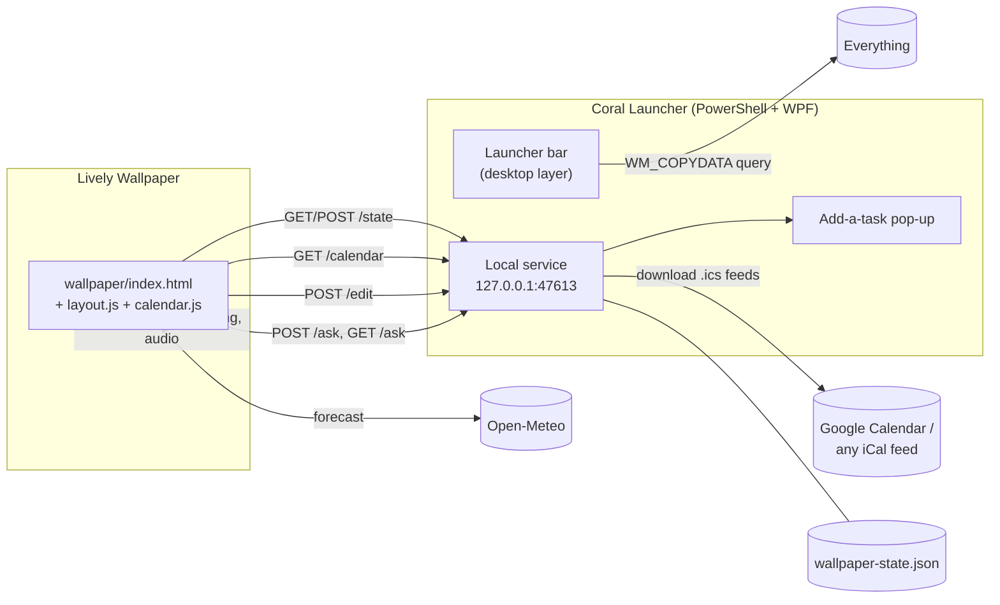

# How it works

Coral Coast has two programs:

- a **web page** that Lively runs as the wallpaper;
- a **PowerShell app** that draws the launcher and helps the wallpaper with the things a wallpaper isn't allowed to do on its own.

## The wallpaper

- **One page across three screens.** `index.html` is a 5760×1080 page shown in Lively's **Span** mode, so the left, center and right screens are three 1920-pixel slices of it.
- **Data from Lively.** It's started with the arguments `--audio --system-information --system-nowplaying`, so Lively calls these JavaScript hooks:
  - `livelySystemInformation` sends CPU, GPU, memory and network figures;
  - `livelyCurrentTrack` sends the song playing in any Windows media app;
  - `livelyAudioListener` sends audio levels for the visualizer;
  - `livelyPropertyListener` sends the values you set in **Customise** (`LivelyProperties.json`).
- **Weather.** The page asks Open-Meteo directly every 30 minutes, and every 2 minutes after a failure.
- **Widget boxes (`layout.js`).**
  - At start-up each module (a card from `index.html`) is measured and moved into a box on the stage.
  - Boxes are sized in grid cells (184×72 px plus 12 px gaps).
  - A **scale** module (gauges, clock, photos) is scaled to fit its box and centred.
  - A **flow** module (to-do, calendar, drives) keeps its design width and fills the box's height. The to-do list folds extra items into "+N more".
  - The layout is saved as `{ v: 2, w: { module: { x, y, cw, ch, hidden } } }`.
- **Calendar (`calendar.js`).**
  - A small iCal parser that understands all-day events, time zones written as UTC or local time, repeating events (`RRULE` daily, weekly, monthly or yearly with `INTERVAL`, `COUNT`, `UNTIL` and `BYDAY`), skipped dates (`EXDATE`) and moved occurrences (`RECURRENCE-ID`).
  - Several feeds arrive back to back, and each event remembers which feed it came from so it can get that feed's colour.

### Why the wallpaper needs the launcher

A wallpaper is a browser page with three limits:

| Limit | What the launcher does about it |
|---|---|
| Lively doesn't keep browser storage between restarts. | The page saves its state (to-dos, layout, calendar view) with `POST /state`. The launcher writes it to `wallpaper-state.json` and hands it back with `GET /state`. |
| Browsers block reading Google Calendar from another site (CORS). | The launcher downloads each `.ics` feed itself and serves them all from `GET /calendar`, cached for 5 minutes. |
| Lively doesn't reliably pass typing to a wallpaper. | Clicking **+ Add a task** sends `POST /ask`. The launcher shows a small text box by the mouse, and the page polls `GET /ask` for the text (`204` = still typing, `200` = text, `410` = cancelled). |

`POST /edit` (`on`, `off` or `reset`) keeps the launcher's move mode in step with the wallpaper's edit mode.

The service is a tiny HTTP server built on a `TcpListener` bound to `127.0.0.1`, so nothing outside this PC can reach it.

## The launcher

`CoralLauncher.vbs` starts PowerShell with no console window, and the work happens in these files:

- **`CoralLauncher.ps1`:** the app logic: tiles, search, menus, settings and the timer.
- **`CoralLauncher.xaml`:** the WPF layout and styles.
- **`CoralNative.cs`:** small Win32 helpers, compiled at start-up with `Add-Type`. It sticks to C# 5 syntax so the compiler built into PowerShell 5.1 can build it.

How it works with Windows:

- **One copy at a time.** A named event (`Local\CoralLauncher.Quit`) asks any running copy to close, and a mutex makes sure the old one is gone before the new one starts. Running the `.vbs` again restarts the launcher.
- **Desktop layer.**
  - Every 400 ms the launcher re-inserts its window just above the window that holds the desktop icons (the one hosting `SHELLDLL_DefView`). That puts it below every app window and in front of the wallpaper.
  - The `WS_EX_TOOLWINDOW` style keeps it out of Alt+Tab.
- **Hotkey.** `RegisterHotKey` plus a hook on the window's message loop (`HwndSource`) catches the key combination and brings the launcher forward.
- **Icons.** `SHGetFileInfo` and `SHGetImageList` (the extra-large list) fetch the same icons Explorer shows.
- **Search.**
  - Local matches come from the category folders.
  - The launcher also sends a query to Everything's hidden IPC window with `WM_COPYDATA`. One query looks for `.lnk`/`.url`/`.exe` apps and one for files and folders.
  - Everything replies with its own `WM_COPYDATA`, which the window hook parses.
- **Start with Windows.** The launcher writes `HKCU\Software\Microsoft\Windows\CurrentVersion\Run\CoralLauncher`, and removes it again when `startWithWindows` is `false`.
- **Position.**
  - By default the bar sits centred above the taskbar of the primary screen.
  - A dragged position is snapped to 20 px and saved to `launcher-position.json`.
  - The launcher re-checks its position every few seconds, because the taskbar may not be ready yet at sign-in.
- **Settings.** `config.json` is re-read whenever it changes, so new calendar addresses take effect within about 5 seconds.

## Notes for hacking on it

- **Keep `CoralLauncher.ps1` ASCII-only.** PowerShell 5.1 reads a file without a BOM as ANSI. In XAML, use entities such as `&#183;` instead of typing the character.
- **Use `$script:` variables in event handlers instead of `GetNewClosure()`.** Inside a closure, `$script:` refers to a different scope.
- **Delegate fields.** PowerShell 5.1 can't parse generic type literals like `[Action[int, string[], int[]]]`, so assign script blocks to delegate fields directly.
- **Changes to `CoralNative.cs` need a launcher restart**, because it's compiled only once per process.
- **Testing the wallpaper in a browser.** Opening `wallpaper/index.html` in a normal browser shows a preview mode with made-up system data. Run the launcher at the same time to test calendar, state and the add-task box.
